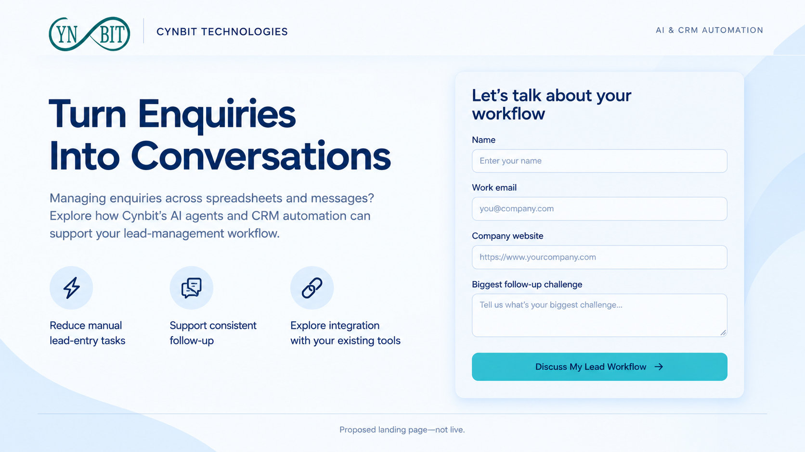

# Turn Enquiries Into Conversations

**Cynbit Growth Marketing Assessment — Sanjana Uprety**

A proposed B2B lead-generation campaign for Cynbit's AI agents and CRM automation services. The objective is to generate qualified discovery-call bookings from small Indian B2B service businesses that manage enquiries and follow-ups manually.

## Start here

- [View / download the campaign presentation (PDF)](Campaign-Presentation.pdf)
- [Download the editable PowerPoint with embedded videos](Campaign-Presentation.pptx)
- [View the landing-page mockup](Landing-Page-Mockup.png)

If GitHub cannot preview a file, use **Download raw file**. Download the PowerPoint and open it in Microsoft PowerPoint desktop; start Slide Show and click the videos on slides 4–6. Playback support varies by viewer. The MP4 files below are also provided separately for straightforward access.

## Marketing creatives

The two primary creative deliverables are **Video 02** and the **landing-page mockup**. Videos 01 and 03 are supplementary alternatives, not additional required deliverables.

| Order | Asset | Role |
| --- | --- | --- |
| 1 | [Video 01](Video-01.mp4) | Alternative campaign video; original horizontal export |
| 2 | [Video 02](Video-02.mp4) | Main campaign video; portrait |
| 3 | [Video 03](Video-03.mp4) | Alternative campaign video; portrait |

The landing page is a visual mockup, not a functional form. Video scenes and workflow imagery are illustrative, not verified product demonstrations. The original creative files are preserved; any claims or branding in them require Cynbit approval before public campaign use.

## Campaign plan and strategy report

The presentation includes:

- Target audience, business problem, discovery-call offer and growth hypothesis.
- Acquisition through Google Search and organic LinkedIn.
- A proposed 30-day pilot with a ₹10,000 media budget.
- CTR, conversion-rate, lead-cost and customer-acquisition-cost planning assumptions.
- A controlled headline A/B test with lead-quality guardrails and sample-size limitations.
- GA4 / GTM and CRM measurement from click to enquiry, qualified lead, booked call and paying customer.
- A 30-day execution roadmap and rules for investigation, iteration and conditional scaling.

**Hypothesis:** Specific messaging about manual lead follow-up will produce a higher enquiry conversion rate than broad automation messaging, without reducing lead quality.

### Illustrative targets

| Metric | Proposed target / assumption |
| --- | --- |
| Google Search CTR | 4% |
| Average CPC | ₹50 planning assumption |
| Landing-page enquiry conversion rate | 5% |
| Enquiries | 10 from an assumed 200 visits |
| Qualified leads | 4 |
| Qualified discovery-call bookings | 2 |
| Cost per enquiry | ₹1,000 |
| Cost per qualified booking | ₹5,000 |
| Provisional media-only CAC goal | ≤₹10,000 per new paying customer, evaluated over a 90-day acquisition cohort |

These figures are planning assumptions, not achieved results or validated forecasts. Confirm keyword demand, CPC, customer gross margin and acceptable acquisition cost before launch. Full CAC includes relevant production and sales costs. With no customer conversions, CAC is not yet measurable.

The pilot is too small for a reliable conclusion on many A/B tests: report uncertainty rather than declaring a winner. Track booked and attended calls separately and retain the original acquisition cohort for later sales conversions.

## Tools and execution notes

AI-assisted creative workflow using Gemini, Google Flow and Google Vids, with assistant-supported campaign writing and presentation assembly. The repository contains marketing deliverables rather than an application; no installation, build or server is required.

No live advertising campaign was launched, no budget was spent, and no leads or customer results are claimed. No employer/customer data is included. This is an applicant-created assessment, not an official Cynbit publication.

## Official sources

- [Cynbit services](https://www.cynbit.in/services)
- [Cynbit contact and discovery enquiries](https://www.cynbit.in/contact)

Service descriptions inform the proposal; website performance claims are not used as verified campaign results.
